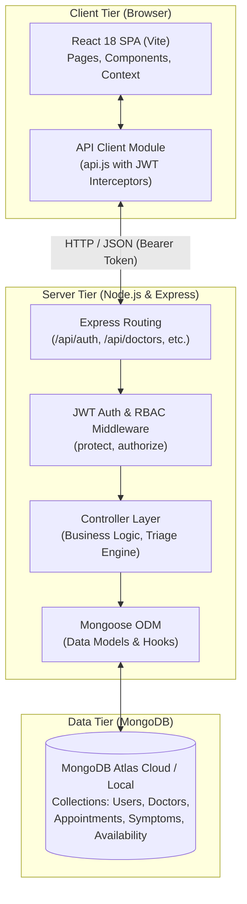

# Smart Doctor Appointment & Clinical Guidance System

> **ICT Academy of Kerala (ICTAK) — Summer Internship Capstone Project**  
> **Course:** Full Stack Application Development with ReactJS  
> **Institution:** Sahrdaya College of Engineering & Technology, Thrissur  
> **Architecture:** MERN Stack (MongoDB, Express.js, React.js, Node.js)

---

## 📋 Table of Contents
1. [Project Overview & Problem Statement](#-project-overview--problem-statement)
2. [Target Users & Role-Based Capabilities](#-target-users--role-based-capabilities)
3. [Architecture & Request Flow](#-architecture--request-flow)
4. [Technology Stack](#-technology-stack)
5. [Project Structure](#-project-structure)
6. [Key Features & Screenshots Overview](#-key-features--screenshots-overview)
7. [Installation & Setup Guide](#-installation--setup-guide)
8. [Demo Credentials Table](#-demo-credentials-table)
9. [REST API Contract](#-rest-api-contract)
10. [Submission Deliverables](#-submission-deliverables)
11. [Hosting & Deployment Guide](#-hosting--deployment-guide)

---

## 🎯 Project Overview & Problem Statement

### Problem Statement
In conventional outpatient healthcare facilities, appointment scheduling is often fragmented, causing long physical wait times, administrative bottlenecks, and patient uncertainty regarding which medical specialty to consult.

### The Solution
The **Smart Doctor Appointment & Clinical Guidance System** is an enterprise-grade digital healthcare platform that provides:
1. **Interactive Clinical Symptom Triage:** A multi-symptom evaluation wizard that aggregates patient complaints, calculates an urgency index (`HIGH`, `MEDIUM`, `LOW`), displays critical warning signs, and automatically links patients to corresponding medical specialists.
2. **Atomic Slot Reservation:** Guarantees collision-free 30-minute consultation slot bookings.
3. **Electronic Consultation Records:** Enables doctors to record clinical observations and issued electronic prescriptions (`Rx`), accessible anytime by the patient.
4. **Hospital Operations Console:** Real-time analytics on patient traffic, practitioner distribution, and revenue.

---

## 👥 Target Users & Role-Based Capabilities

| Role | Permissions & Capabilities |
|---|---|
| **Patient** | • Self-registration & profile management.<br>• Clinical symptom checker with automated risk triage.<br>• Search & filter doctors by department, rating, fee, and experience.<br>• Real-time 30-minute slot booking.<br>• Patient dashboard: view upcoming consultations, cancellation, and prescription history. |
| **Doctor** | • Manage upcoming consultation calendar (filter by date and status).<br>• Accept / Confirm or Cancel scheduled appointments.<br>• Complete consultations by submitting clinical observations and digital prescriptions.<br>• Configure availability slots for upcoming days. |
| **Administrator** | • Hospital-wide KPI dashboard (patients, doctors, appointments, revenue).<br>• Register and onboard new doctor accounts.<br>• Audit all hospital consultation records. |

---

## 🏗️ Architecture & Request Flow



### Request Flow Example: Booking an Appointment
1. **User Action:** Patient selects a date and a 30-minute time slot, and clicks "Confirm & Schedule".
2. **Frontend Validation:** Form checks slot selection and passes authorization token via `api.appointment.book()`.
3. **Middleware:** `protect` middleware decodes and verifies the JWT token, injecting `req.user`.
4. **Controller Logic:** `bookAppointment` controller checks if the slot is unreserved. If available, it atomically sets `isBooked: true` on the `Availability` document and creates an `Appointment` document with status `'confirmed'`.
5. **Response:** Status `201 Created` returned with populated doctor and patient metadata.
6. **UI Update:** React updates local state and redirects to the Patient Dashboard without full page refresh.

---

## 💻 Technology Stack

### Frontend
- **React.js 18** (Vite build tool)
- **React Router DOM 6** (Client-side SPA routing)
- **Lucide React** (Modern accessible icon suite)
- **Vanilla Modern CSS** (Responsive custom design system, zero bloated heavy frameworks)

### Backend
- **Node.js** (v18+ runtime)
- **Express.js 4** (RESTful API framework)
- **JSON Web Token (JWT)** (Stateless authorization)
- **bcryptjs** (Password salting & cryptographic hashing)
- **CORS & Morgan** (Cross-origin security & HTTP request logging)

### Database
- **MongoDB** with **Mongoose ODM 8** (Schema enforcement, relationships, indexes, pre-save hooks)

---

## 📁 Project Structure

```
project/
├── client/                               # React 18 Application (Vite)
│   ├── src/
│   │   ├── components/                   # Reusable UI pieces
│   │   │   ├── Alert.jsx                 # Error, warning, success alerts
│   │   │   ├── BookingModal.jsx          # Interactive slot reservation modal
│   │   │   ├── EmptyState.jsx            # Zero-data friendly state display
│   │   │   ├── Footer.jsx                # Clinical disclaimer & links
│   │   │   ├── LoadingSpinner.jsx        # Animated loading state
│   │   │   ├── Navbar.jsx                # Responsive navigation & role badges
│   │   │   └── ProtectedRoute.jsx        # RBAC route guard
│   │   ├── context/
│   │   │   └── AuthContext.jsx           # Global user authentication state
│   │   ├── pages/                        # Screen routes
│   │   │   ├── Home.jsx                  # Hospital landing & quick demo switcher
│   │   │   ├── Login.jsx                 # Sign in with instant autofill
│   │   │   ├── Register.jsx              # Patient registration
│   │   │   ├── DoctorsList.jsx           # Directory with filters & search
│   │   │   ├── SymptomChecker.jsx        # Interactive triage & doctor matching
│   │   │   ├── PatientDashboard.jsx      # Appointments, history & prescriptions
│   │   │   ├── DoctorDashboard.jsx       # Doctor roster & prescription writer
│   │   │   └── AdminDashboard.jsx        # Hospital KPIs & doctor management
│   │   ├── services/
│   │   │   └── api.js                    # Centralized API client module
│   │   ├── App.jsx                       # Routing setup
│   │   ├── index.css                     # Custom clinical design system
│   │   └── main.jsx                      # Vite entry point
│   ├── .env.example                      # Client environment sample
│   ├── index.html                        # HTML5 template
│   ├── package.json
│   └── vite.config.js
│
├── server/                               # Node.js / Express API
│   ├── src/
│   │   ├── config/                       # Database configuration
│   │   │   └── db.js                     # MongoDB connection handler
│   │   ├── controllers/                  # Request handling logic
│   │   │   ├── adminController.js        # KPI stats & doctor creation
│   │   │   ├── appointmentController.js  # Booking & status lifecycle
│   │   │   ├── authController.js         # Register, login & profile
│   │   │   ├── doctorController.js       # Directory & availability
│   │   │   └── symptomController.js      # Symptom triage & department matching
│   │   ├── data/                         # Seed data & automated populator
│   │   │   ├── seedData.js               # Departments, symptoms & doctors data
│   │   │   └── seed.js                   # Database seeding script
│   │   ├── middleware/                   # Express middleware
│   │   │   ├── auth.js                   # JWT verification & RBAC guard
│   │   │   └── errorHandler.js           # Centralized JSON error interceptor
│   │   ├── models/                       # Mongoose schemas
│   │   │   ├── Appointment.js            # Appointment record schema
│   │   │   ├── Availability.js           # Doctor date & slot schema
│   │   │   ├── Doctor.js                 # Doctor profile schema
│   │   │   ├── Specialization.js         # Medical department schema
│   │   │   ├── Symptom.js                # Clinical symptom & guidance schema
│   │   │   └── User.js                   # User account schema with bcrypt
│   │   ├── routes/                       # Express API route mapping
│   │   │   ├── adminRoutes.js
│   │   │   ├── appointmentRoutes.js
│   │   │   ├── authRoutes.js
│   │   │   ├── doctorRoutes.js
│   │   │   └── symptomRoutes.js
│   │   └── server.js                     # Express app & server startup
│   ├── .env.example                      # Server environment sample
│   └── package.json
│
├── docs/                                 # Capstone documentation deliverables
│   ├── Software_Requirements_Specification_SRS.docx
│   ├── Software_Requirements_Specification_SRS.md
│   ├── Summer_Internship_Final_Report.docx
│   └── Summer_Internship_Final_Report.md
├── scripts/
│   └── generateDocx.js                   # Automated Word document generator
├── .gitignore
├── package.json                          # Root orchestration scripts
└── README.md                             # Comprehensive project documentation
```

---

## 🚀 Installation & Setup Guide

### 1. Prerequisites
- **Node.js** (v18.0.0 or higher): Verify with `node -v`
- **npm** (v9.0.0 or higher): Verify with `npm -v`
- **Git**: Verify with `git --version`
- **MongoDB Atlas** account (or local MongoDB daemon)

### 2. Clone and Setup
```bash
# Clone the repository
git clone <YOUR_PUBLIC_GITHUB_REPO_URL>
cd project

# Install backend dependencies
cd server
npm install

# Install frontend dependencies
cd ../client
npm install
```

### 3. Environment Configuration
Create `.env` inside `server/` (refer to `server/.env.example`):
```env
PORT=5000
NODE_ENV=development
MONGODB_URI=mongodb+srv://<username>:<password>@cluster0.xxxx.mongodb.net/smart_doctor_db?retryWrites=true&w=majority
JWT_SECRET=smart_doctor_super_secret_jwt_key_2026_capstone_ictak
JWT_EXPIRES_IN=7d
CLIENT_URL=http://localhost:5173
```

Create `.env` inside `client/` (refer to `client/.env.example`):
```env
VITE_API_URL=http://localhost:5000/api
```

### 4. Seed the Database
Populate the database with medical departments, clinical symptoms, and doctor schedules:
```bash
cd server
npm run seed
```

### 5. Run the Application
In terminal 1 (start backend API):
```bash
cd server
npm run dev
# Server running at: http://localhost:5000
# Health check: http://localhost:5000/api/health
```

In terminal 2 (start React client):
```bash
cd client
npm run dev
# Frontend running at: http://localhost:5173
```

---

## 🔑 Demo Credentials Table

For easy evaluation, use any of these pre-seeded demo credentials or click the **Instant Demo Login** buttons on the login screen:

### Core Evaluation Accounts
| Role | Username / Login ID | Password | Account Details & Available Views |
|---|---|---|---|
| **Patient** | `patient1` | `pat123` | **Ananya Menon:** View booked consultations, cancel appointments, read doctor's prescription notes. |
| **Doctor** | `dr.rajesh` | `doc123` | **Dr. Rajesh Kumar (Cardiology):** View patient queue, confirm consultations, write clinical notes & prescriptions. |
| **Admin** | `admin` | `admin123` | **Hospital Administrator:** Hospital KPI metrics, audit all bookings, register new medical practitioners. |

### Complete 24 Specialists Roster (18 Medical Departments)
All 24 physicians are pre-seeded in the database with password `doc123`:

| Doctor Name | Department / Specialty | Username / Login ID | Experience & Fee |
|---|---|---|---|
| **Dr. Rajesh Kumar** | Cardiology | `dr.rajesh` | 14 yrs • ₹750 |
| **Dr. Aarav Nair** | Neurology | `dr.aarav` | 12 yrs • ₹800 |
| **Dr. Priya Nair** | Dermatology | `dr.priya` | 9 yrs • ₹600 |
| **Dr. Sarah George** | Pediatrics | `dr.sarah` | 10 yrs • ₹500 |
| **Dr. Aditya Paul** | Orthopedics | `dr.aditya` | 15 yrs • ₹700 |
| **Dr. Meera Thomas** | General Medicine | `dr.meera` | 11 yrs • ₹450 |
| **Dr. Ananya Das** | Endocrinology & Diabetology | `dr.ananya` | 10 yrs • ₹650 |
| **Dr. Nikhil Varma** | Ophthalmology | `dr.nikhil` | 8 yrs • ₹550 |
| **Dr. Vivek Kumar** | Gastroenterology | `dr.vivek` | 13 yrs • ₹750 |
| **Dr. Diya Mathew** | Pulmonology | `dr.diya.mathew` | 11 yrs • ₹650 |
| **Dr. Anand Menon** | ENT (Otolaryngology) | `dr.anand` | 14 yrs • ₹550 |
| **Dr. Rahul Menon** | Nephrology & Urology | `dr.rahul` | 12 yrs • ₹700 |
| **Dr. Neha Joseph** | Psychiatry | `dr.neha` | 13 yrs • ₹650 |
| **Dr. Alan George** | Cardiology | `dr.alan` | 16 yrs • ₹800 |
| **Dr. Diya Thomas** | Gynecology & Obstetrics | `dr.diya.thomas` | 12 yrs • ₹600 |
| **Dr. Joel Mathew** | Oncology | `dr.joel` | 15 yrs • ₹900 |
| **Dr. Kevin Mathew** | Rheumatology & Immunology | `dr.kevin.mathew` | 10 yrs • ₹650 |
| **Dr. Sara Paul** | Dermatology | `dr.sara` | 8 yrs • ₹550 |
| **Dr. Thomas Joseph** | Orthopedics | `dr.thomas` | 17 yrs • ₹750 |
| **Dr. Riya Nair** | Pediatrics | `dr.riya` | 7 yrs • ₹450 |
| **Dr. Fathima Ali** | General Surgery | `dr.fathima` | 11 yrs • ₹650 |
| **Dr. Kevin Paul** | Neurology | `dr.kevin.paul` | 9 yrs • ₹700 |
| **Dr. Maria George** | General Medicine | `dr.maria` | 13 yrs • ₹500 |
| **Dr. David Thomas** | Dentistry & Maxillofacial | `dr.david` | 10 yrs • ₹450 |

---

## 📡 REST API Contract

| Method | Endpoint | Access | Purpose | Success Code |
|---|---|---|---|---|
| `POST` | `/api/auth/register` | Public | Register new patient account | `201 Created` |
| `POST` | `/api/auth/login` | Public | Authenticate user & return JWT token | `200 OK` |
| `GET` | `/api/auth/me` | Private | Retrieve authenticated user profile | `200 OK` |
| `GET` | `/api/doctors` | Public | List verified doctors with search & filters | `200 OK` |
| `GET` | `/api/doctors/:id` | Public | Get doctor profile and upcoming availability | `200 OK` |
| `POST` | `/api/doctors/availability` | Doctor/Admin | Create availability slots for a date | `200 OK` |
| `POST` | `/api/appointments` | Patient | Book 30-minute consultation slot | `201 Created` |
| `GET` | `/api/appointments/my` | Patient | List patient's consultation records | `200 OK` |
| `GET` | `/api/appointments/doctor` | Doctor | List doctor's assigned patient appointments | `200 OK` |
| `PATCH` | `/api/appointments/:id/status` | Doctor/Admin | Confirm, cancel, or complete with Rx | `200 OK` |
| `DELETE` | `/api/appointments/:id` | Patient/Doctor | Cancel appointment & release slot | `200 OK` |
| `GET` | `/api/symptoms` | Public | List symptoms catalog | `200 OK` |
| `POST` | `/api/symptoms/check` | Public | Run clinical triage matrix & match doctors | `200 OK` |
| `GET` | `/api/admin/stats` | Admin | Get hospital KPI metrics | `200 OK` |
| `POST` | `/api/admin/doctors` | Admin | Register new doctor account & profile | `201 Created` |

---

## 📄 Submission Deliverables

The repository includes both submission deliverables requested by ICTAK:
1. **Software Requirements Specification (SRS):**
   - Available in Microsoft Word format: [`Software_Requirements_Specification_SRS.docx`](./Software_Requirements_Specification_SRS.docx)
   - Available in Markdown format: [`docs/Software_Requirements_Specification_SRS.md`](./docs/Software_Requirements_Specification_SRS.md)
   - *Directly upload this file to the LMS "Software Requirements Specification Submission" portal.*
2. **Summer Internship Final Report:**
   - Available in Microsoft Word format: [`Summer_Internship_Final_Report.docx`](./Summer_Internship_Final_Report.docx)
   - Available in Markdown format: [`docs/Summer_Internship_Final_Report.md`](./docs/Summer_Internship_Final_Report.md)
   - *Directly upload this file to the LMS "Final Project Submission" portal.*

---

## 🌐 Hosting & Deployment Guide

### Deploying the Backend (Render.com / Railway)
1. Push repository to your public GitHub account.
2. In **Render.com**, select **New Web Service** and link your repository.
3. Configure settings:
   - **Root Directory:** `server`
   - **Build Command:** `npm install`
   - **Start Command:** `npm start`
4. Set Environment Variables in the Render dashboard:
   - `MONGODB_URI`: Your MongoDB Atlas connection string.
   - `JWT_SECRET`: A secure random secret string.
   - `CLIENT_URL`: Your hosted frontend URL (e.g. `https://smart-doctor-portal.vercel.app`).
   - `NODE_ENV`: `production`

### Deploying the Frontend (Vercel / Netlify)
1. In **Vercel**, select **Add New Project** and link your repository.
2. Configure settings:
   - **Root Directory:** `client`
   - **Build Command:** `npm run build`
   - **Output Directory:** `dist`
3. Set Environment Variable in Vercel:
   - `VITE_API_URL`: Your live backend URL + `/api` (e.g. `https://smart-doctor-api.onrender.com/api`).
4. Enable Single Page Application (SPA) rewrite by ensuring `index.html` serves as fallback for route refresh.

---

## 🛡️ License
Developed under the **ICT Academy of Kerala (ICTAK)** Summer Internship Program (2026).
Academic and evaluation use authorized.
