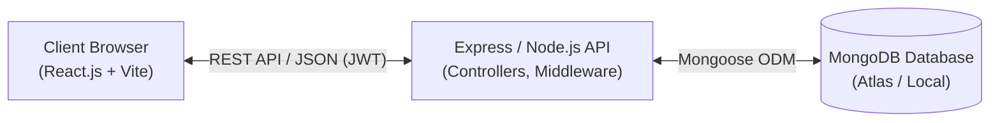
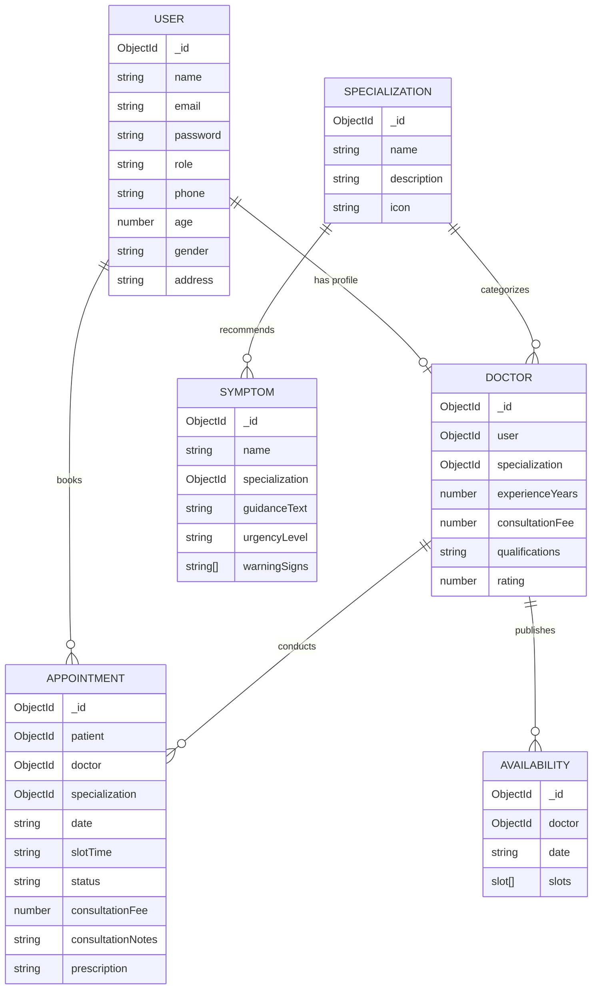

# Software Requirements Specification (SRS)
## Smart Doctor Appointment & Clinical Guidance System

---

### Document Control & Metadata
- **Project Title:** Smart Doctor Appointment & Clinical Guidance System
- **Academic Program:** Full Stack Application Development with ReactJS
- **Organization:** Information and Communication Technology Academy of Kerala (ICTAK)
- **Institution:** Sahrdaya College of Engineering & Technology, Thrissur
- **Document Version:** 1.0.0
- **Standard:** IEEE Std 830-1998 (Recommended Practice for Software Requirements Specifications)
- **Status:** Approved for Submission

---

## 1. Introduction

### 1.1 Purpose
This Software Requirements Specification (SRS) defines the complete software, functional, non-functional, interface, and behavioral requirements for the **Smart Doctor Appointment & Clinical Guidance System**. The system is a full-stack web application designed to bridge the accessibility gap between healthcare seekers and board-certified medical professionals.

### 1.2 Document Conventions
- **MUST / SHALL:** Mandatory requirements essential for system deployment and compliance.
- **SHOULD:** Highly recommended capabilities that provide significant operational value.
- **MAY:** Optional or future-scope enhancements.

### 1.3 Intended Audience
This document is authored for academic evaluators, technical mentors, project reviewers from ICT Academy of Kerala (ICTAK), software engineers, quality assurance testers, and healthcare administrators.

### 1.4 Project Scope
The Smart Doctor Appointment System streamlines outpatient clinical scheduling across 18 medical departments with 24 verified specialist physicians through:
1. **Interactive Clinical Symptom Triage:** A multi-symptom evaluation wizard (22+ symptoms) that analyzes reported ailments, calculates an urgency index (`HIGH`, `MEDIUM`, `LOW`), displays critical warning signs, and automatically links patients to corresponding medical specialists across Cardiology, Neurology, Dermatology, Pediatrics, Orthopedics, General Medicine, Psychiatry, Ophthalmology, ENT, Gastroenterology, Pulmonology, Endocrinology, Nephrology, Gynecology, Oncology, Rheumatology, General Surgery, and Dentistry.
2. **Physician Directory & Live Slot Reservation:** Patients search 24+ doctors by medical specialty, experience, and fee, and select available 30-minute consultation slots.
3. **Role-Based Portals:**
   - **Patient Portal:** Appointment booking, live status tracking (`pending`, `confirmed`, `completed`, `cancelled`), and access to physician consultation notes and prescriptions.
   - **Doctor Portal:** Consultation calendar management, appointment confirmation/rejection, availability slot creation, and clinical notes/prescription recording.
   - **Administrator Console:** Hospital-wide KPI analytics (patient counts, doctor roster, revenue tracking), doctor credential management, and comprehensive appointment audit logs.

### 1.5 References
- IEEE Std 830-1998: IEEE Recommended Practice for Software Requirements Specifications.
- ICTAK MERN Stack Project Guidelines & Student Reference Guide (2026).
- OWASP Top 10 Web Application Security Risks (2021).
- ReactJS, Express.js, Node.js, and MongoDB Official Documentation.

---

## 2. Overall Description

### 2.1 Product Perspective
The system operates as an independent, cloud-ready single-page application (SPA) built on the MERN (MongoDB, Express.js, React.js, Node.js) technology stack. The React client communicates with the Node.js/Express RESTful API using JSON payloads over HTTPS.

### 2.2 User Classes and Characteristics
| User Class | Description | Technical Competence |
|---|---|---|
| **Patient** | General public seeking healthcare appointments, preliminary symptom guidance, and digital consultation records. | Novice / Everyday web user |
| **Doctor** | Licensed medical practitioners managing clinical availability, accepting patient consultations, and recording prescriptions. | Moderate web user |
| **Administrator** | Hospital operations staff overseeing practitioner onboarding, department configuration, and hospital-wide scheduling metrics. | Advanced web user |

### 2.3 Operating Environment
- **Client Tier:** Modern web browsers (Google Chrome 110+, Mozilla Firefox 110+, Apple Safari 16+, Microsoft Edge) supporting HTML5, CSS3, and ES6 JavaScript.
- **Server Tier:** Node.js runtime environment (v18.0.0 or higher), Express.js 4.19+.
- **Database Tier:** MongoDB Atlas cloud cluster (MongoDB 6.0+) or local MongoDB daemon with replica-set / standalone support.

### 2.4 Design and Implementation Constraints
1. **Architectural Separation:** Strict separation between presentation (client-side React SPA) and business logic (server-side Express REST API).
2. **Security Compliance:** Passwords must be hashed using `bcrypt` (10 salt rounds) before database persistence. No plain-text secrets in source control.
3. **Emergency Care Boundary:** The symptom triage system must display prominent legal and clinical disclaimers stating that algorithmic suggestions do not constitute a licensed medical diagnosis.

### 2.5 Assumptions and Dependencies
- Network connectivity exists between the client browser, API server, and MongoDB cluster.
- Time slot conflicts are managed atomically to prevent double-booking.

---

## 3. System Features & Functional Requirements

### 3.1 Authentication & Authorization Module
- **FR-AUTH-01:** System shall permit new patients to register with name, email, password, phone, age, gender, and address.
- **FR-AUTH-02:** System shall authenticate users via email/username and password, issuing a signed JSON Web Token (JWT) with a 7-day expiration.
- **FR-AUTH-03:** System shall enforce role-based access control (RBAC). Protected routes must reject requests from unauthorized roles with HTTP status `403 Forbidden`.
- **FR-AUTH-04:** Passwords must contain a minimum of 6 characters and be securely salted and hashed.

### 3.2 Physician Directory & Search Module
- **FR-DOC-01:** System shall display all on-duty doctors with name, department/specialization, qualifications, experience, rating, and consultation fee.
- **FR-DOC-02:** Users can filter doctors by specialization, search by name, and specify minimum years of clinical experience.
- **FR-DOC-03:** System shall display doctor availability for the selected calendar date.

### 3.3 Appointment Scheduling & Slot Booking Module
- **FR-APT-01:** Registered patients can select a date and an unreserved 30-minute time slot.
- **FR-APT-02:** Upon booking submission, the system atomically marks the availability slot as booked (`isBooked: true`) and creates an appointment record.
- **FR-APT-03:** The system must prevent duplicate bookings on the same doctor and slot time.
- **FR-APT-04:** Patients may cancel pending or confirmed appointments, which automatically frees the time slot for other patients.

### 3.4 Clinical Symptom Checker & Health Triage Module
- **FR-SYM-01:** The system shall present an interactive catalog of common medical symptoms categorized by department.
- **FR-SYM-02:** When the user selects symptoms and clicks "Run Triage Analysis", the system determines:
  - **Overall Urgency Index:** `HIGH` (immediate emergency care needed), `MEDIUM` (consultation within 24-48 hours), or `LOW` (mild, self-limiting).
  - **Clinical Guidance Summary:** Clear action steps for the patient.
  - **Red-Flag Warning Signs:** Critical signs requiring emergency intervention.
  - **Recommended Specialists:** Direct links to on-duty doctors matching the diagnosed department.

### 3.5 Doctor Consultation & Prescription Module
- **FR-DOC-05:** Doctors can view their appointment roster filtered by date and status.
- **FR-DOC-06:** Doctors can accept/confirm an appointment, cancel an appointment, or finalize the appointment by submitting clinical notes and prescription instructions.
- **FR-DOC-07:** Doctors can add new availability slots for any calendar date.

### 3.6 Administrator Console & Analytics Module
- **FR-ADM-01:** Admins can view hospital KPIs: total patients, active doctors, total appointments, revenue generated, and appointment status distribution.
- **FR-ADM-02:** Admins can create new doctor accounts, assign medical departments, and set consultation fees.
- **FR-ADM-03:** Admins can view an audit log of all hospital appointments.

---

## 4. External Interface Requirements

### 4.1 User Interfaces
- Responsive UI adhering to mobile-first responsive principles.
- Every view implements the 4 standard application states: **Loading**, **Success**, **Empty**, and **Error**.
- Modal dialogs for appointment scheduling, clinical note entry, and doctor account creation.

### 4.2 Software Interfaces
- **Frontend:** React 18 with Vite build pipeline and React Router DOM.
- **Backend:** Node.js with Express.js REST API.
- **Database:** MongoDB via Mongoose Object Data Modeling (ODM).

### 4.3 Communications Interfaces
- All client-server communication uses HTTPS with standard REST verbs:
  - `GET`: Read resources without side-effects (200 OK).
  - `POST`: Create resources (201 Created).
  - `PATCH` / `PUT`: Modify resources (200 OK).
  - `DELETE`: Remove resources (200 OK).
- Cross-Origin Resource Sharing (CORS) configured with allowed client origin whitelist.

---

## 5. Non-Functional Requirements

### 5.1 Performance Requirements
- API response times for standard queries (doctor listing, symptom lookup) must be under 300ms under standard network conditions.
- Client bundle size minimized via Vite code-splitting and production tree-shaking.

### 5.2 Security & Privacy Requirements
- **NFR-SEC-01:** Cryptographic password hashing using `bcryptjs` with salt rounds = 10.
- **NFR-SEC-02:** Stateless authentication using cryptographically signed JWT tokens.
- **NFR-SEC-03:** Server-side input validation and parameter sanitization to protect against NoSQL injection.
- **NFR-SEC-04:** Environment variable isolation: secrets (`JWT_SECRET`, `MONGODB_URI`) never checked into version control.

### 5.3 Reliability and Error Handling
- Unhandled server exceptions intercepted by centralized error-handling middleware.
- Client gracefully handles server downtime or network disconnects with retry options.

---

## 6. Data Model & Database Schema

---

## 7. Verification & Acceptance Criteria Matrix

| Requirement ID | Test Case Description | Expected Result | Status |
|---|---|---|---|
| **TC-01** | User Registration with valid credentials | User created in DB with hashed password; JWT token returned | Passed |
| **TC-02** | User Registration with duplicate email | HTTP 409 Conflict with descriptive message | Passed |
| **TC-03** | User Login with invalid password | HTTP 401 Unauthorized; token not issued | Passed |
| **TC-04** | Role-Based Access: Patient accessing `/api/admin/stats` | HTTP 403 Forbidden | Passed |
| **TC-05** | Doctor search by department & name | Matching doctor profiles returned with rating and fees | Passed |
| **TC-06** | Slot Reservation & Double-Booking prevention | Slot marked `isBooked: true`; duplicate request rejected | Passed |
| **TC-07** | Symptom Triage Analysis with acute symptoms | Urgency flagged `HIGH`, emergency disclaimer shown, specialist matched | Passed |
| **TC-08** | Doctor recording clinical notes & prescription | Appointment updated to `completed`, notes accessible in Patient Dashboard | Passed |
