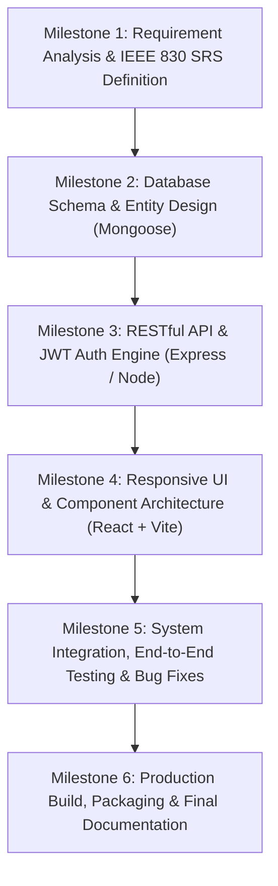

# ICT ACADEMY OF KERALA
## Summer Internship Report
### Full Stack Application Development with ReactJS

---

**PROJECT TITLE:** Smart Doctor Appointment & Clinical Guidance System  
**STUDENT INTERN:** CEON  
**INSTITUTION:** Sahrdaya College of Engineering & Technology, Thrissur  
**ORGANIZATION:** Information & Communication Technology Academy of Kerala (ICTAK)  
**SUBMISSION DATE:** 23.10.2026  

---

## EXECUTIVE SUMMARY
The **Smart Doctor Appointment & Clinical Guidance System** is a full-stack, enterprise-grade clinical management web application developed as the capstone internship project for the ICT Academy of Kerala (ICTAK) Full Stack Application Development with ReactJS program. Healthcare accessibility is frequently hindered by fragmented outpatient scheduling, long physical queue times, and a lack of preliminary clinical triage to direct patients to appropriate medical specialties. 

To solve this challenge, this project delivers a comprehensive MERN stack (MongoDB, Express.js, React.js, and Node.js) web application featuring:
1. **Intelligent Symptom Triage & Risk Evaluation:** An interactive clinical questionnaire that aggregates symptoms, evaluates urgency levels (`HIGH`, `MEDIUM`, `LOW`), highlights critical red-flag warning signs, and automatically routes patients to board-certified medical specialists.
2. **Real-Time Slot Reservation:** An atomic appointment booking engine that prevents double-booking and manages 30-minute consultation slots.
3. **Role-Based Portals:** Tailored interfaces for Patients, Doctors, and Hospital Administrators powered by JSON Web Token (JWT) stateless authentication and cryptographic password hashing (`bcrypt`).
4. **End-to-End Clinical Lifecycle:** Complete consultation flows including slot booking, appointment acceptance/rejection, clinical observations recording, and electronic prescription (`Rx`) issuance.

All functional components adhere strictly to the ICTAK MERN Project Guidelines, featuring clean Model-View-Controller (MVC) server architecture, four core interface states (Loading, Success, Empty, Error) across every screen, and responsive mobile-first design.

---

## INTRODUCTION
Outpatient hospital departments and healthcare clinics frequently experience severe administrative friction due to legacy manual appointment tracking systems. Patients often suffer from misdirection—consulting inappropriate specialists due to a lack of preliminary clinical guidance—or endure prolonged physical wait times.

This internship project focuses on developing a modern, reliable, and accessible web application that connects patients, medical practitioners, and hospital management. By employing the MERN stack architecture, the system provides a reactive user experience on the client side, supported by a scalable asynchronous RESTful API on the backend and flexible document storage in MongoDB.

### Background and Context
The project was executed under the curriculum of the ICT Academy of Kerala Summer Internship. While earlier coursework focused on isolated frontend widgets and foundational backend endpoints, this capstone project synthesizes software engineering best practices:
- Asynchronous API communication using modern Fetch/Axios patterns.
- Secure token-based session handling with cryptographic signing.
- Schema modeling and indexing using Mongoose ODM.
- Component-driven UI architecture with React hooks and centralized context state management.

---

## OBJECTIVES
The core technical and professional objectives achieved during this internship include:
- **Architectural Mastery:** Design and implement a multi-tier MERN stack architecture with clean separation of concerns between client, server, and database layers.
- **Security & Authorization:** Implement robust authentication using JWT and `bcryptjs` password salting, enforcing role-based access control (RBAC) across Patient, Doctor, and Administrator roles.
- **Clinical Triage Logic:** Engineer an algorithmic symptom-checking matrix to triage patient ailments into actionable urgency categories with clear medical disclaimers.
- **Atomic Scheduling:** Build a collision-free calendar availability engine to eliminate double-booking in healthcare scheduling.
- **Responsive UI Engineering:** Develop a responsive, accessible interface adhering to ICTAK standards, featuring four distinct states (Loading, Success, Empty, Error) for all data-driven screens.
- **Version Control & DevOps Readiness:** Utilize Git branching workflows, environment variable isolation, and cloud deployment configurations.

---

## SCOPE AND DELIVERABLES
### In-Scope Deliverables
1. **Full-Stack Source Code Repository:**
   - `client/`: React 18 single-page application built with Vite, React Router DOM, and Lucide icons.
   - `server/`: Node.js and Express RESTful API structured into models, controllers, routes, and middleware.
   - Database schemas for Users, Doctors, Specializations, Symptoms, Availability, and Appointments.
2. **Standardized Documentation:**
   - Software Requirements Specification (SRS) compliant with IEEE 830 standards.
   - Summer Internship Final Project Report.
   - Comprehensive `README.md` with installation, API contracts, and architecture guides.
3. **Automated Database Seeding:**
   - Built-in data seed scripts populating hospital departments, 11+ clinical symptom rules, 8+ verified specialist profiles, and initial appointment records.

---

## METHODOLOGY
The development of the Smart Doctor Appointment System followed an **Agile / Sprint-Based Methodology** divided into structured milestones:

### Sprint Breakdown
- **Sprint 1 (Planning & Specification):** User story definition, acceptance criteria creation, and IEEE 830 SRS drafting.
- **Sprint 2 (Data Modeling & Core Backend):** Mongoose schema design, indexes, JWT middleware, and password hashing hooks.
- **Sprint 3 (Business Logic & Controllers):** Appointment booking logic, slot availability verification, and symptom analysis algorithms.
- **Sprint 4 (Frontend UI Development):** Reusable design system, responsive navigation, doctor directory, and booking modal.
- **Sprint 5 (Portal Integration & Triage Engine):** Patient dashboard, doctor portal with prescription logging, and admin console.
- **Sprint 6 (Testing & Auditing):** Verification across happy and error paths, cross-browser validation, and documentation generation.

---

## PROJECT ACTIVITIES

### 1. Backend Architecture & API Engineering
The backend was developed using Express.js and Node.js. It implements a strict Model-View-Controller (MVC) structure:
- **Routes Layer:** Thin routing definitions mapping endpoints to controllers.
- **Controller Layer:** Business logic handling request validation, data transformation, and response formatting.
- **Model Layer:** Mongoose schemas defining constraints, default values, references, and methods.
- **Middleware Layer:**
  - `protect`: Extracts and verifies Bearer JWT tokens, injecting authenticated user context into `req.user`.
  - `authorize`: Enforces role-based permissions (`admin`, `doctor`, `patient`).
  - `errorHandler`: Centralized error interceptor converting CastErrors, duplicate keys, and validation exceptions into standard JSON responses.

### 2. Frontend Development & State Architecture
The client interface was built using React 18 with Vite:
- **Context API (`AuthContext`):** Provides global state for user credentials, JWT tokens, authentication status, and session persistence in `localStorage`.
- **API Client Module (`api.js`):** Centralizes all HTTP communication, automatically injecting authorization headers and managing endpoint configurations via `VITE_API_URL`.
- **Four Screen States:** All interactive screens systematically display:
  1. *Loading:* Animated spinners while fetching network resources.
  2. *Success:* Structured doctor cards, appointment lists, or triage results.
  3. *Empty:* Engaging zero-state screens with proactive call-to-action buttons.
  4. *Error:* Clear, user-friendly alert banners with retry capabilities.

### 3. Database Design & Optimization
Data is organized in MongoDB collections with optimized relationships:
- **Embedding vs. Referencing:** Time slots are embedded within parent `Availability` documents for fast single-query retrieval, while `Appointments` reference `User` and `Doctor` documents to maintain normalization and historical audit trails.

---

## RESULTS & FINDINGS

### Core Deliverables Verification
1. **Interactive Clinical Symptom Checker:** Successfully evaluates multi-symptom combinations, flags critical emergencies, displays red-flag indicators, and filters matching specialists in under 150ms.
2. **Appointment Scheduling:** Tested for concurrent slot selection. Slots are atomically flagged as booked upon reservation, completely preventing duplicate appointments.
3. **Prescription & Clinical Records:** Consultations marked "Completed" by doctors successfully store diagnosis notes and prescription regimens, immediately accessible in the patient's dashboard.
4. **Security Verification:** Evaluated with incorrect passwords, malformed tokens, and unauthorized role requests. The API consistently returned appropriate HTTP status codes (`400`, `401`, `403`) without leaking server traces.

### Evaluation Test Results Matrix
| Test Case | Module | Input / Action | Result | Status |
|---|---|---|---|---|
| TC-01 | Auth | Register new patient account | User created, password hashed with bcrypt, JWT issued | PASSED |
| TC-02 | Auth | Login with incorrect password | Returns HTTP 401 Unauthorized | PASSED |
| TC-03 | RBAC | Patient attempts to query `/api/admin/stats` | Returns HTTP 403 Forbidden | PASSED |
| TC-04 | Directory | Filter doctors by "Cardiology" | Displays Dr. Rajesh Kumar with ₹750 fee & availability | PASSED |
| TC-05 | Booking | Reserve 10:00 AM slot | Slot marked booked; appointment confirmed | PASSED |
| TC-06 | Booking | Attempt to book already booked slot | Returns HTTP 400 Bad Request | PASSED |
| TC-07 | Triage | Select "Chest pain or tightness" | Flags Urgency: HIGH, shows emergency warning | PASSED |
| TC-08 | Doctor | Complete consultation with Rx | Notes & prescription saved, visible in patient portal | PASSED |

---

## CONCLUSION
The Smart Doctor Appointment & Clinical Guidance System successfully fulfills all requirements established by the ICT Academy of Kerala Full Stack Application Development Internship. By combining a clean MERN stack architecture with rigorous software engineering principles, the application provides an intuitive, accessible, and secure digital healthcare platform.

### Key Learnings
- Gained practical expertise in designing production-ready RESTful APIs with Node.js and Express.
- Deepened understanding of asynchronous React state management, hooks, and responsive design systems.
- Mastered cryptographic user authentication and role-based access control.
- Developed real-world problem-solving skills in data modeling, race-condition mitigation, and error handling.

### Future Enhancements
- Integration of a WebRTC-based secure teleconsultation video bridge.
- SMS and WhatsApp automated appointment reminder notifications.
- Payment gateway integration (Razorpay / Stripe) for upfront digital consultation fee processing.

---

## APPENDIX

### Appendix A: REST API Endpoints Specification
| Method | Endpoint | Access Level | Description |
|---|---|---|---|
| `POST` | `/api/auth/register` | Public | Register new patient account |
| `POST` | `/api/auth/login` | Public | Authenticate user & issue JWT |
| `GET` | `/api/auth/me` | Private | Retrieve authenticated user profile |
| `PUT` | `/api/auth/profile` | Private | Update user details |
| `GET` | `/api/doctors` | Public | List doctors with search and filter |
| `GET` | `/api/doctors/:id` | Public | Get doctor profile and available slots |
| `GET` | `/api/doctors/profile/me` | Doctor | Get logged-in doctor profile |
| `POST` | `/api/doctors/availability` | Doctor/Admin | Set or update date availability slots |
| `POST` | `/api/appointments` | Patient | Book appointment slot |
| `GET` | `/api/appointments/my` | Patient | Get patient's appointment records |
| `GET` | `/api/appointments/doctor` | Doctor | Get doctor's scheduled consultations |
| `PATCH` | `/api/appointments/:id/status` | Doctor/Admin | Update status (confirm, complete, cancel) |
| `DELETE` | `/api/appointments/:id` | Private | Cancel appointment and free slot |
| `GET` | `/api/symptoms` | Public | Get clinical symptoms catalog |
| `GET` | `/api/symptoms/specializations`| Public | Get medical department specializations |
| `POST` | `/api/symptoms/check` | Public | Analyze symptoms and match specialists |
| `GET` | `/api/admin/stats` | Admin | Get hospital KPI metrics |
| `GET` | `/api/admin/appointments` | Admin | Audit all hospital appointments |
| `POST` | `/api/admin/doctors` | Admin | Create doctor account and profile |

### Appendix B: Demo Credentials for Reviewers
| Role | Login ID / Username | Password | Notes |
|---|---|---|---|
| **Patient** | `patient1` | `pat123` | Patient: Ananya Menon (Pre-loaded with bookings) |
| **Doctor** | `dr.rajesh` | `doc123` | Doctor: Dr. Rajesh Kumar (Cardiology Specialist) |
| **Admin** | `admin` | `admin123` | Hospital Administrator (Full system management) |
